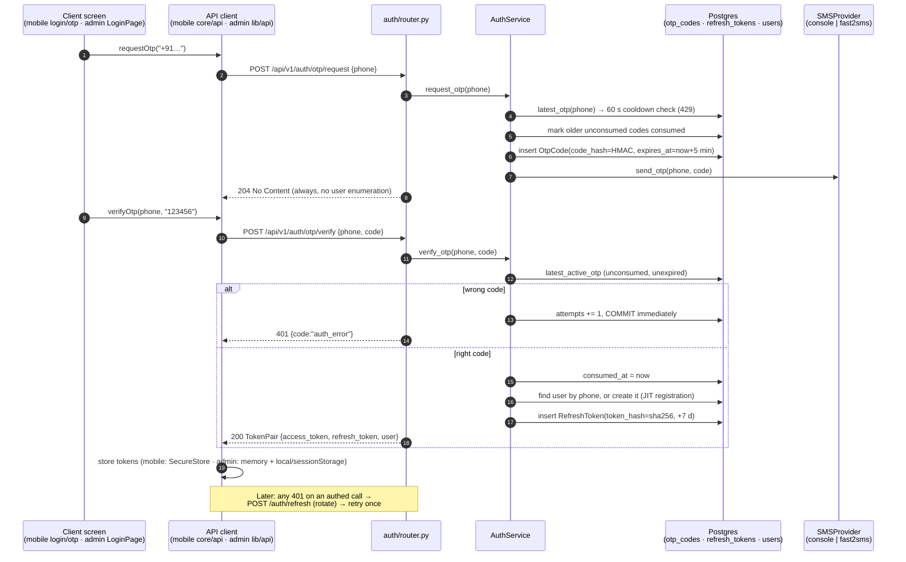

# Auth — Phone OTP Sign-in Flow

> **Verified against:** branch `backend-module-first-restructure`, HEAD `3a3463d` + working tree (2026-10-18).
> When you change any file in [Source map](#source-map), update this page and bump the line above.
> Original design intent: `docs/superpowers/specs/2026-10-09-backend-increment1-design.md`, `…-mobile-increment1-auth-design.md`. This page tracks the code as it is today.

Atelier has no passwords. Every client (mobile app and admin console) signs in by phone number + 6-digit SMS code.
All clients call the same three backend endpoints. The admin console adds a client-side `admin` role check.

---

## 1. Big picture



---

## 2. Backend (`backend/app`)

### Endpoints — `auth/router.py`
All routes are mounted under `/api/v1` by `app/router.py`.

| Method & path | Body | Success | Errors |
|---|---|---|---|
| `POST /auth/otp/request` | `{phone}` | **204** (no body) | 422 bad phone · 429 `rate_limited` (within 60 s cooldown) · 500 if SMS send fails |
| `POST /auth/otp/verify` | `{phone, code}` | **200** `TokenPair` | 422 bad phone/code shape · 401 `auth_error` "Invalid or expired code" |
| `POST /auth/refresh` | `{refresh_token}` | **200** `TokenPair` (rotated) | 401 `auth_error` |

`TokenPair` = `{access_token, refresh_token, token_type: "bearer", user: UserOut}` (`auth/schemas.py`).
`UserOut` carries `roles`, `active_role`, `is_onboarded`, and the profile fields (`user/schemas.py`).

### Validation — `auth/schemas.py`
- `phone`: E.164, regex `^\+[1-9]\d{6,14}$`. Failing it returns a FastAPI 422 `{detail:[…]}`. This is **not** the `{code,message}` shape.
- `code`: exactly 6 digits, `^\d{6}$`.

### Business rules — `auth/service.py` (`AuthService`)
| Rule | Where | Setting (`core/config.py`) |
|---|---|---|
| Resend cooldown per phone | `request_otp` → `latest_otp` | `otp_resend_cooldown_seconds = 60` |
| A new code invalidates older unconsumed codes | `request_otp` → `unconsumed_otps` | — |
| Code lifetime | `OtpCode.expires_at` | `otp_ttl_minutes = 5` |
| Max wrong guesses per code | `verify_otp` | `otp_max_attempts = 5` |
| Failed guess is persisted before raising | `verify_otp`: `await session.commit()` before `AuthError` | — |
| A code works once | `consumed_at` set on success | — |
| Unknown phone signs up automatically | `verify_otp`: creates `User(role_grants=[])` | — |
| Refresh tokens rotate on every use | `refresh`: old row gets `revoked_at` | `refresh_token_ttl_days = 7` |
| Access token lifetime | `core/security.create_access_token` | `access_token_ttl_minutes = 15` |

**Why the explicit commit on a wrong guess:** `core/database.get_db` commits on success and rolls back on any exception.
Without the commit, the `attempts += 1` would be rolled back with the 401, and the lockout could never trigger.

### Crypto — `core/security.py`
- `generate_otp()`: `secrets.randbelow(1_000_000)`, zero-padded to 6 digits.
- `hash_otp(code)`: HMAC-SHA256 keyed with `JWT_SECRET`. A 6-digit code has too little entropy for a plain hash.
- `hash_token(token)`: plain SHA-256. Refresh JWTs are already high-entropy.
- JWT payload: `{sub: user_id, type: "access"|"refresh", jti, iat, exp}`, HS256.
- No plaintext OTP or refresh token is ever stored.

### Tables — `auth/models.py`
- `otp_codes`: `phone` (indexed), `code_hash`, `expires_at`, `attempts`, `consumed_at`, plus timestamps.
- `refresh_tokens`: `user_id → users.id` (cascade), `token_hash` (unique), `expires_at`, `revoked_at`.

### SMS delivery — `auth/sms.py`
Chosen by the `SMS_PROVIDER` env var:
- `console` (default, dev/tests): logs `Your Art Circle code is NNNNNN` on logger `art_circle.sms`. It also appends to `ConsoleSMSProvider.sent`, so tests can read the code. In local dev, **find the code in the backend terminal**.
- `fast2sms`: POSTs to Fast2SMS's `otp` route with `FAST2SMS_API_KEY`, and strips the leading `91` from the number. A failed send raises `RuntimeError` → 500. The request rolls back, so no OTP row is stored and no cooldown starts.

### Protecting other routes — `core/auth.py`
- `get_current_user`: reads `Authorization: Bearer <access>`, requires `type == "access"`, and loads an active user. Otherwise 401.
- `require_role(UserRole.X)`: returns 403 `forbidden` if the user doesn't hold that role. Admin endpoints use this.

---

## 3. Mobile (`mobile/`)

| Layer | File | Role |
|---|---|---|
| Screen | `app/(auth)/login.tsx` | Phone entry (defaults to `+91`). The client-side regex matches the backend's E.164 rule. On 204 it routes to `/otp?phone=…`. Shows a custom message for `rate_limited`. |
| Screen | `app/(auth)/otp.tsx` | `OtpInput` auto-submits at 6 digits. `auth_error` → "That code is incorrect." + shake + clear. Other errors keep the digits so the user can retry. A 60 s resend countdown mirrors the backend cooldown. |
| Hook | `src/hooks/auth/auth.ts` | `useRequestOtp()` = `useMutation(requestOtp)`. |
| Request decls | `src/api/auth/auth.ts` | `requestOtp`, `verifyOtp`, `refreshSession`, all POSTs via `core/api/client.request`. |
| Session state | `src/context/auth/auth-provider.tsx` | `status: restoring → unauthenticated / authenticated`. `verifyOtp` → `applyPair` → `sessionStore.save` → `setUser`. |
| Token storage | `src/utils/auth/session-store.ts` | `expo-secure-store`. Only `ac.refresh_token` is persisted; the access token stays in memory. `clear()` also removes the legacy `ac.access_token`. Falls back to `localStorage` on web preview only. |
| HTTP | `src/core/api/client.ts`, `real-transport.ts` | Base `EXPO_PUBLIC_API_URL + /api/v1` with a 15 s timeout. On a 401 for an `auth: true` call it does **one** refresh, then one retry. |
| Routing gate | `src/utils/auth/routing.ts`, `app/_layout.tsx`, `app/index.tsx` | `destination()` sends the user to `auth` (signed out), `onboarding` (`!is_onboarded`), or `artist`/`customer` (by `active_role`). |

**Cold start:** if a refresh token is stored, the app calls `/auth/refresh`. Success means signed in; failure means signed out. The splash stays up while `status === 'restoring'`.

**Refresh dedupe:** `pendingRefresh` ref. Concurrent 401s share one refresh. This matters because a rotated token can only be used once, so a second refresh with the old token would fail and log the user out.

**After the first OTP:** a new user has `is_onboarded = false` and is routed to `/signup` (no name yet) or `/choose-role`.

---

## 4. Admin console (`admin/`)

| Layer | File | Role |
|---|---|---|
| Screen | `src/features/auth/LoginPage.tsx` | Two steps (`phone` → `code`). Fixed `+91` with 10-digit validation. `InputOTP` auto-submits on complete. Has a "Keep me signed in" checkbox and a Resend link (no countdown; the backend 429 message is shown). |
| Request decls + hooks | `src/features/auth/api.ts` | `useRequestOtp`, `useVerifyOtp`. `verifyAdminOtp` **rejects pairs whose `user.roles` lacks `admin`** before storing them (`not_admin`). |
| Session state | `src/features/auth/AuthProvider.tsx` | `restoring / signedOut / signedIn`. Restores via `refreshSession()` + `GET /users/me`, then re-checks the admin role. |
| HTTP + tokens | `src/lib/api.ts` | Access token **in memory only**. Refresh token goes to `localStorage` (keep signed in) or `sessionStorage`. A 401 on a non-`/auth/` path → one shared refresh → retry. If that fails, `onExpired` → sign out. Maps both `{code,message}` and FastAPI 422 `detail`. |

---

## 5. Error contract (what clients branch on)

`main.py` turns every `AppError` into `{code, message}` with the matching HTTP status:

| HTTP | `code` | Raised by |
|---|---|---|
| 401 | `auth_error` | wrong, expired, consumed, or locked OTP; bad, revoked, or expired refresh |
| 403 | `forbidden` | `require_role` |
| 429 | `rate_limited` | resend inside the 60 s cooldown |
| 422 | *(none: FastAPI `{detail}`)* | schema validation (phone / code shape) |
| — | `network_error` | mobile transport only (timeout or offline) |
| — | `not_admin` | admin client only (never from the backend) |

---

## 6. Tests

- Backend `backend/tests/test_auth.py`: JIT user creation, one-shot verify, wrong code → 401, lockout after max attempts, cooldown → 429, invalid phone → 422, refresh rotation revokes the old token, expired code rejected. Run from `backend/` with `uv run pytest -q tests/test_auth.py`.
- Backend `backend/tests/test_security.py`: hashing and JWT primitives.
- Mobile `src/components/common/__tests__/otp-input.test.tsx`, `src/__tests__/core/real-transport.test.ts`.
- Admin `src/App.test.tsx`: login flow (OTP mocks in `src/test/setup.ts`).

---

## 7. Known gaps / follow-ups (observed, not yet fixed)

1. **Admin sign-in by a non-admin still has server-side effects.** `/otp/verify` consumes the code, JIT-creates a `users` row for any phone typed into the admin console, and inserts a `refresh_tokens` row. The client then discards the tokens. A server-side admin login check, or skipping JIT on admin, would avoid orphan accounts and token rows.
2. **No server-side logout.** Sign-out on both clients only clears local storage. The refresh token stays valid until its 7-day expiry. Consider `POST /auth/logout` to set `revoked_at`.
3. **No refresh-token reuse detection.** Presenting an already-rotated token just returns 401. It does not revoke the rest of that token family.
4. **Throttling is per phone only.** There is a 60 s cooldown and 5 guesses per code, which works out to about 5 guesses per minute per phone. There is no per-IP limit and no daily cap on SMS sends, which is a cost and abuse risk once `fast2sms` is live.
5. ~~Mobile maps FastAPI 422 to a generic message.~~ **Fixed 2026-10-18.** `core/api/client.toApiError` now maps a code-less 422 to `validation_error` with the first `detail[].msg` (Pydantic's `Value error, ` prefix stripped). Test: `src/__tests__/core/client.test.ts`.
6. **`JWT_SECRET` doubles as the OTP HMAC key.** Rotating it invalidates every in-flight code as well as every token. A dedicated `OTP_HMAC_SECRET` would decouple the two.
7. **Admin refresh token lives in Web Storage.** This is flagged in the `lib/api.ts` comment and conflicts with CLAUDE.md §10 (httpOnly cookie). Fix before the admin app is ever public.
8. ~~Mobile saves `ac.access_token` to SecureStore but never reads it back.~~ **Fixed 2026-10-18.** `session-store.save` persists only the refresh token; `clear` still deletes the legacy key. Test: `src/__tests__/auth/session-store.test.ts`.

---

## Source map

```
backend/app/auth/router.py        endpoints
backend/app/auth/schemas.py       OTPRequest / OTPVerify / RefreshRequest / TokenPair
backend/app/auth/service.py       AuthService: request_otp, verify_otp, refresh
backend/app/auth/repository.py    OTP + refresh-token queries
backend/app/auth/models.py        otp_codes, refresh_tokens
backend/app/auth/sms.py           Console / Fast2SMS providers
backend/app/auth/dependencies.py  get_auth_service
backend/app/core/security.py      generate_otp, hash_otp, hash_token, JWTs
backend/app/core/auth.py          get_current_user, require_role
backend/app/core/config.py        TTLs, limits, SMS_PROVIDER, FAST2SMS_API_KEY
backend/app/core/database.py      get_db (commit/rollback per request)
backend/app/main.py               AppError → {code, message}

mobile/app/(auth)/login.tsx, otp.tsx
mobile/src/api/auth/auth.ts
mobile/src/hooks/auth/auth.ts
mobile/src/context/auth/auth-provider.tsx
mobile/src/utils/auth/session-store.ts, routing.ts
mobile/src/core/api/client.ts, real-transport.ts

admin/src/features/auth/LoginPage.tsx, api.ts, AuthProvider.tsx
admin/src/lib/api.ts
```
