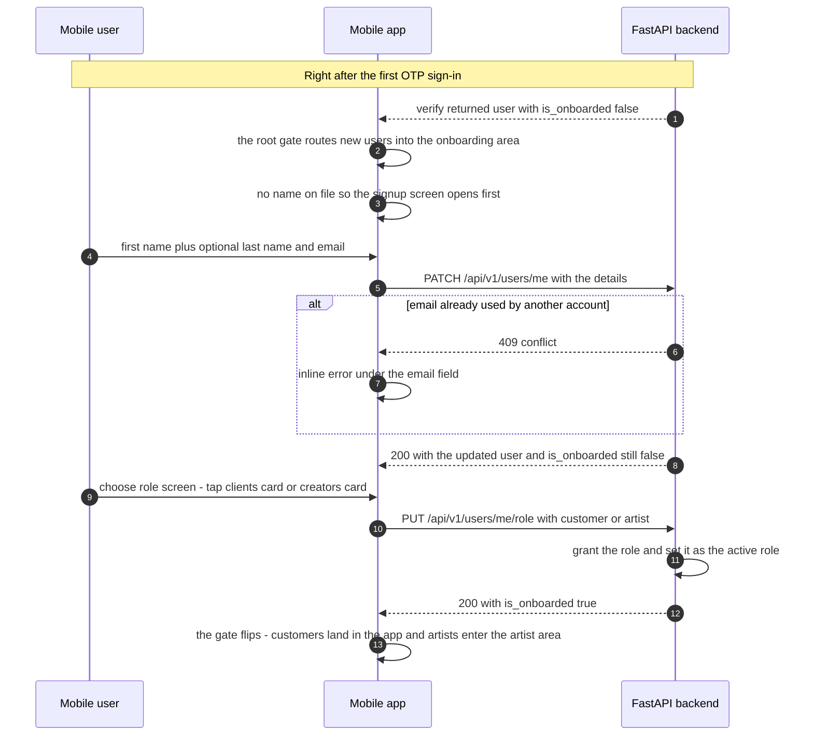
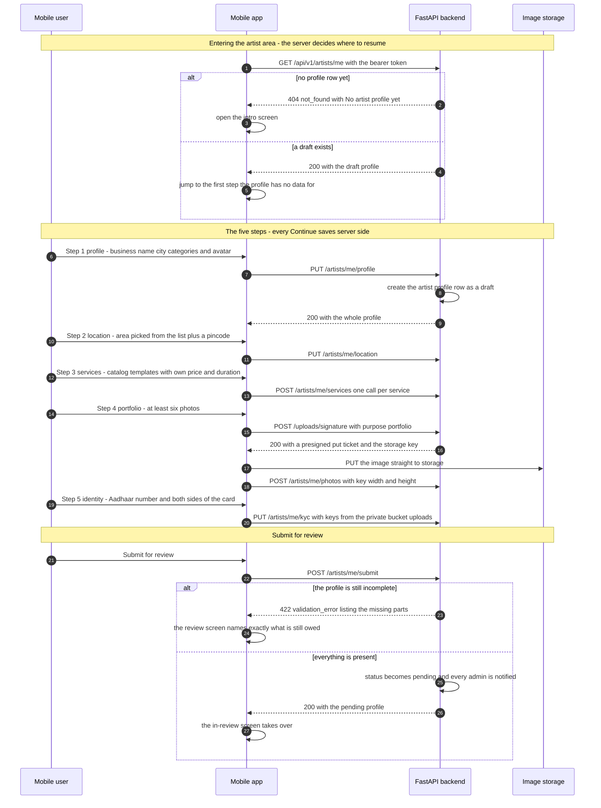
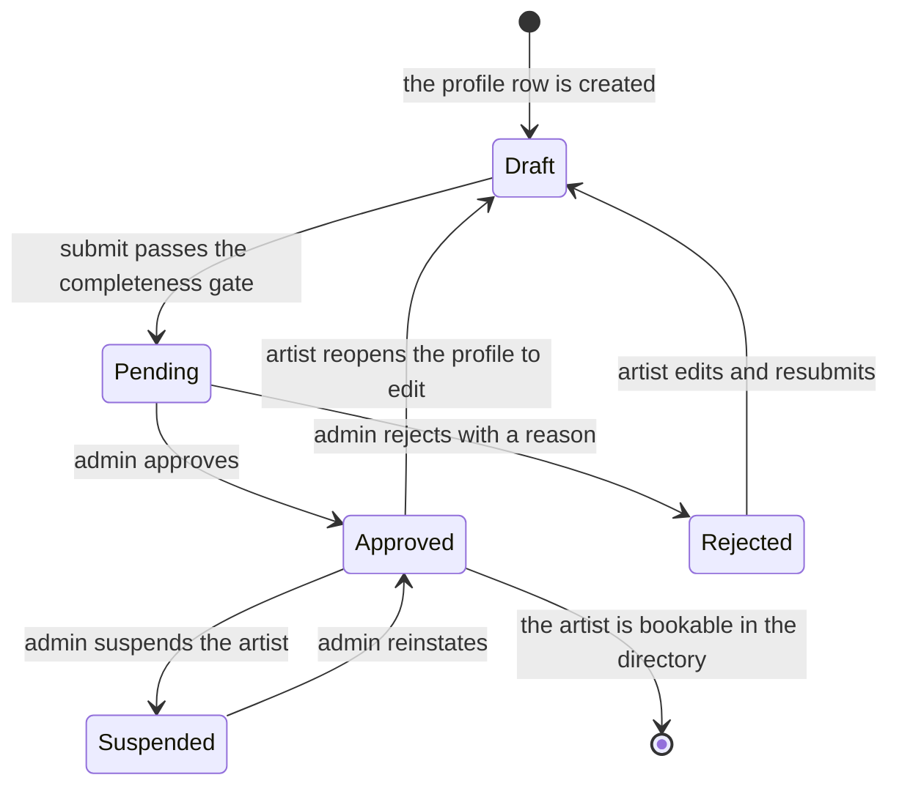

# Onboarding — Technical Walkthrough & Live Demo Runbook

> Milestone showcase companion to `2026-10-31-otp-flow-walkthrough.md` (GetReady / Art Circle).
> Every response below was captured live against the dev backend on 2026-10-31 — nothing is illustrative.

Onboarding happens **after** the passwordless OTP sign-in and has two layers:

1. **Account onboarding** (every new user): name → choose role. A customer is fully
   onboarded the moment they tap a role; there are no further gates.
2. **Artist profile onboarding** (only after choosing *artist*): five server-saved steps,
   then a submit-for-review state machine (draft → pending → approved / rejected) with
   admin approval before the artist appears in the directory.

There is no wizard-only state: **each Continue saves to the server**, so closing the app
mid-way resumes at the first step the server has no data for — even on another device.

---

## 1. The flow at a glance

Account onboarding, continuing straight out of the OTP demo:



Artist profile onboarding — resume, five steps, submit:



The review state machine (admins act from the admin panel):



`GET /artists/me` on every entry into the artist area is what picks the mounted screen
group — draft resumes the five steps, pending or rejected shows the review screen,
approved opens the full artist app (home, bookings, calendar, shop, posts).

---

## 2. Screen-by-screen (what the client sees)

| Step | Screen | Behaviour |
|------|--------|-----------|
| — | `mobile/app/(auth)/login.tsx` → `otp.tsx` | The companion OTP doc covers sign-in; a brand-new number pops into existence here (JIT registration). |
| 0 | `mobile/app/(onboarding)/signup.tsx` | "What's your name?" — first + last side by side, optional email. Continue disabled until the first name is filled. 409 → "That email is already used by another account." Back = sign out (the number is already verified, so there is no OTP to return to). |
| 1 | `mobile/app/(onboarding)/choose-role.tsx` | Two split cards — *Book an artist* (clients) / *Offer my services* (creators). Tapping saves the role server-side; the footer promises "You can switch roles anytime" (it really can — `PUT /users/me/role` again). |
| 2a | `mobile/app/customer/` group | Choosing *customer* sets `is_onboarded: true` and lands directly in the browse-and-book app. Done. |
| 2b | `mobile/app/artist/onboarding/intro.tsx` | Choosing *artist* opens the artist area: photo collage, two benefit lines, "5 short steps". The close button signs out (role already chosen). |
| 3 | `onboarding/profile.tsx` | STEP 1 · PROFILE — business name, city, 1–6 categories, avatar. This write creates the draft row. |
| 4 | `onboarding/location.tsx` | STEP 2 · LOCATION — area chosen from the pre-populated list (`GET /areas?city=`), never free text, plus a 6-digit Indian PIN code; a private house/studio line is optional. |
| 5 | `onboarding/services.tsx` | STEP 3 · SERVICES — "Add what clients can book. You need at least one service." Prices come from catalog templates with the artist's own price and duration; custom proposals wait for admin approval one by one. |
| 6 | `onboarding/portfolio.tsx` | STEP 4 · PORTFOLIO — "Add at least 6 photos. Your first photo becomes your cover." Photos upload straight to object storage with a presigned ticket (they never pass through the API process). |
| 7 | `onboarding/identity.tsx` | STEP 5 · IDENTITY — Aadhaar number + both sides of the card into a **private** bucket, then **Submit for review**. Once saved, the screen only ever shows the last 4 digits; the number and images are never sent back to the app. |
| 8 | `artist/in-review.tsx` | Waiting room for pending and rejected profiles; a rejected profile shows the admin's reason and an *Edit and resubmit* button that reopens the five steps. |

Routing truth tables: `mobile/src/utils/auth/routing.ts` (account level) and
`mobile/src/utils/artist-onboarding/routing.ts` (artist level) — both drive Expo Router
`Stack.Protected` guards, so crossing a boundary drops the old screens from history
(no back-navigation into onboarding once onboarded).

---

## 3. API contracts (real captured examples)

Base URL: `/api/v1`. Errors keep the same stable shape as the OTP flow
(`{ "code": …, "message": … }`); the client branches on `code`.

### 3.1 `PATCH /users/me` — save sign-up details

```json
{ "first_name": "Demo", "last_name": "User", "email": null, "whatsapp_booking_updates": true }
```
200 (user excerpt — still not onboarded; the name alone never flips the gate):
```json
{ "first_name": "Demo", "is_onboarded": false, "active_role": null, "roles": [] }
```
Duplicate email → `409 { "code": "conflict", … }`.

### 3.2 `PUT /users/me/role` — the switch that opens the app

Request `{ "role": "artist" }` → 200 (excerpt):
```json
{ "roles": ["artist"], "active_role": "artist", "is_onboarded": true }
```
Roles accumulate (`customer` and `artist` can both be granted); `active_role` picks which
side the app shows. `is_onboarded` is a server-side property: `active_role is not None`.

### 3.3 `GET /artists/me` — resume signal

Artist role but no profile row yet →
```json
{ "code": "not_found", "message": "No artist profile yet" }
```

### 3.4 `GET /categories` — the catalog tree the Profile step consumes

First top-level entry, live:
```json
{
  "id": 1, "slug": "mehendi", "name": "Mehendi",
  "subcategories": [
    { "id": 2, "slug": "bridal-mehendi", "name": "Bridal Mehendi",
      "services": [ { "id": 1, "name": "Bridal Full Hands + Legs",
        "description": "Complete bridal design, both hands up to elbow and legs up to knee." } ] },
    { "id": 3, "slug": "party-mehendi", "name": "Party Mehendi",
      "services": [ { "id": 2, "name": "Simple Hands" }, { "id": 3, "name": "Guest Mehendi (per person)" } ] }
  ]
}
```

### 3.5 `PUT /artists/me/profile` — creates the draft row (verbatim 200 body)

```json
{
  "id": "70171607-195e-4e3c-b858-8a9aeb305507",
  "status": "draft",
  "business_name": "Demo Demo Studio",
  "city": "Bangalore",
  "area_id": null, "locality": null, "pincode": null,
  "address_line": null, "latitude": null, "longitude": null,
  "bio": "first draft save",
  "experience_years": null, "languages": [],
  "photo_key": null, "photo_url": null,
  "categories": [ { "id": 1, "slug": "mehendi", "name": "Mehendi" } ],
  "services": [], "photos": [], "kyc": null,
  "rejection_reason": null, "submitted_at": null, "reviewed_at": null
}
```
Every onboarding write returns the **whole profile**, so the app re-renders from one
response — no GET needed between steps.

### 3.6 `PUT /artists/me/location` — area id from `GET /areas?city=Bangalore` (first area, id 8)

```json
{ "area_id": 8, "city": "Bangalore", "pincode": "560001" }
```
The area row sets the canonical city; PIN code must match `^[1-9][0-9]{5}$` and
latitude/longitude are accepted only as a pair.

### 3.7 `POST /artists/me/submit` — the completeness gate (verbatim 422)

Captured while the draft still lacked photo/services/portfolio/kyc:
```json
{
  "code": "validation_error",
  "message": "Profile is incomplete",
  "missing": ["photo", "services", "portfolio", "kyc"],
  "min_photos": 6
}
```
When everything is present: status flips to `pending`, `submitted_at` is stamped, and
every admin receives an `artist_submitted` notification (oldest-first review queue).
Edits are only allowed while `draft` or `rejected` — submitting twice races a `409`.

### 3.8 `POST /uploads/signature` — direct-to-storage upload ticket

Contract from `backend/app/upload/schemas.py` (presigned PUT verified live end-to-end
during the 2026-10-31 R2 upload fix — 200 against both the public and the private bucket):
```json
{
  "upload_url": "https://<bucket>.r2.cloudflarestorage.com/…?X-Amz-Signature=…",
  "method": "PUT",
  "fields": {},
  "headers": { "content-type": "image/jpeg" },
  "key": "artists/…/portfolio/<uuid>.jpg"
}
```
`purpose` is a closed list: `artist_photo` · `portfolio` · `aadhaar` · `post` · `shop` ·
`service`. Aadhaar uploads land in a **private** bucket; the app then hands only the
returned `key` to `POST /artists/me/photos` or `PUT /artists/me/kyc`. Rate limit:
300 signatures / user / hour.

### 3.9 KYC privacy

`PUT /artists/me/kyc` accepts the 12-digit Aadhaar number (checksum-validated in the
service so failures keep the `{code, message}` contract) plus the two private keys.
What the app can read back afterwards is only:
```json
{ "kyc": { "aadhaar_last4": "6789" } }
```
Admins reveal the full number through a separate, audited endpoint
(`POST /admin/artists/{id}/kyc/reveal`, recorded in the `AadhaarReveal` table).

---

## 4. Guards & invariants (why the data stays trustworthy)

| Rule | Where |
|------|-------|
| Gate is server-derived: name alone ≠ onboarded; a role flips it | `is_onboarded` property, `app/user/models.py` |
| A verified phone cannot impersonate: details collected on our account only | Bearer auth on both endpoints |
| Categories: 1–6 per artist, ids must exist | `ProfileIn` in `app/artist/schemas.py` |
| Location is a catalog area, not free text (Bangalore 35 / Mumbai 22 / … pre-populated by migration) | `LocationIn` + `catalog_area` |
| Prices stored in **paise**, `> 0`; duration 1–1440 min | `ServiceIn` |
| At least one service and 6–30 portfolio photos to pass submit | `submit()` in `app/artist/service.py` |
| Every step saves → resume across restarts/devices is exact | `resumeStep()` + write-each-step API |
| Submitted profiles are locked until admin decides | `EDITABLE = {draft, rejected}` |
| Rejected → edit → resubmit keeps the review history honest (`reviewed_at` marks re-review) | `app/artist/service.py`, admin queue |
| Reopening an approved profile hides it from the directory until re-approved | `POST /artists/me/reopen` |
| Suspended artists leave the directory but keep their data | admin suspend / reinstate |
| Images bypass the API process (presigned PUT) — no image bytes through the server | `app/upload/router.py` |
| Aadhaar images: private bucket; number never echoed to any client; admin reveals audited | `KycOut`, `AadhaarReveal` |
| Admins are notified on every submission — the queue never sleeps | `notify_admins` on submit |

---

## 5. Live demo runbook

### Path A — mobile app (hero demo, continues the OTP demo)

1. Sign in with a **fresh** number (see the OTP doc's rate-limit note) — the app lands on
   the signup screen before you can reach anything else.
2. Type a name → Continue. Show the gate refusing empty first names.
3. Choose role screen → tap **For clients** → app instantly becomes the customer browsing
   app. (Switch later to show role switching, or restart the app — it comes back here.)
4. Sign out / sign in with a fresh number → tap **For creators** → artist intro appears.
5. Walk the five steps: profile (draft row is created here — mention "saved server-side
   every step"), location (only listed areas accepted), services, portfolio (6-photo
   minimum enforcement is visible), identity (Aadhaar + card sides; show that after saving
   only the last 4 are displayed).
6. Before finishing everything, tap **Submit** once to demo the 422 completeness gate
   naming the missing parts — then complete and submit → in-review screen.
7. In the admin panel: approve the profile → the app flips into the full artist workspace
   and the artist appears in the customer directory.

### Path B — curl (the exact sequence captured for this doc)

```bash
BASE=http://localhost:8000/api/v1
PHONE=+919000000777          # fresh number per run

# 1. sign in (see OTP runbook) and keep the token
curl -s -o /dev/null -X POST $BASE/auth/otp/request -H 'content-type: application/json' \
     -d "{\"phone\":\"$PHONE\"}"
grep "console-sms" logs/api.log | tail -1        # read the code
TOKEN=$(curl -s -X POST $BASE/auth/otp/verify -H 'content-type: application/json' \
        -d "{\"phone\":\"$PHONE\",\"code\":\"<paste>\"}" \
        | python3 -c 'import json,sys; print(json.load(sys.stdin)["access_token"])')
A="Authorization: Bearer $TOKEN"

# 2. account onboarding: name, then role (watch is_onboarded flip)
curl -s -X PATCH $BASE/users/me -H "$A" -H 'content-type: application/json' \
     -d '{"first_name":"Demo","last_name":"User","email":null,"whatsapp_booking_updates":true}'
curl -s -X PUT $BASE/users/me/role -H "$A" -H 'content-type: application/json' \
     -d '{"role":"artist"}'

# 3. no profile yet → 404 is the resume signal
curl -s $BASE/artists/me -H "$A"

# 4. step 1 creates the draft; step 2 uses a real area id
curl -s -X PUT $BASE/artists/me/profile -H "$A" -H 'content-type: application/json' \
     -d '{"business_name":"Demo Demo Studio","city":"Bangalore","category_ids":[1]}'
AREA=$(curl -s "$BASE/areas?city=Bangalore" -H "$A" \
       | python3 -c 'import json,sys; print(json.load(sys.stdin)[0]["id"])')
curl -s -X PUT $BASE/artists/me/location -H "$A" -H 'content-type: application/json' \
     -d "{\"area_id\":$AREA,\"pincode\":\"560001\"}"

# 5. the completeness gate
curl -s -X POST $BASE/artists/me/submit -H "$A"
# → {"code":"validation_error","missing":["photo","services","portfolio","kyc"],"min_photos":6}
```

> Demo-day notes: numbers `…333`, `…444`, `…555` were consumed while writing this doc
> (per-phone OTP cap is 5 requests/hour) — start each run with a new one. `…555` now owns
> the draft profile *Demo Demo Studio*, ready to finish live if you want an approval run.

---

## 6. Where the code lives

| Concern | File |
|---------|------|
| Root gate + area guards | `mobile/app/_layout.tsx`, `mobile/src/utils/auth/routing.ts` |
| Signup / choose-role screens | `mobile/app/(onboarding)/signup.tsx`, `choose-role.tsx` |
| Account writes (details, role) | `backend/app/user/router.py`, `service.py` |
| Artist area stage guards | `mobile/app/artist/_layout.tsx`, `src/utils/artist-onboarding/routing.ts` |
| Five onboarding steps | `mobile/app/artist/onboarding/*.tsx` |
| Profile lifecycle rules (draft/pending/approved/rejected, submit gate) | `backend/app/artist/service.py` |
| Artist endpoints (all under `/artists/me`) | `backend/app/artist/router.py`, `schemas.py` |
| Presigned upload seam | `backend/app/upload/router.py`, `schemas.py` |
| Admin review + KYC reveal | `backend/app/artist/admin_router.py`, `admin_service.py` |
| Admin review UI | `admin/src/features/` (Art Circle admin panel) |
| Behavior tests (readable spec) | `backend/tests/test_artists.py`, `tests/test_users.py` |
| Mobile onboarding tests | `mobile/src/__tests__/artist-onboarding/` |
