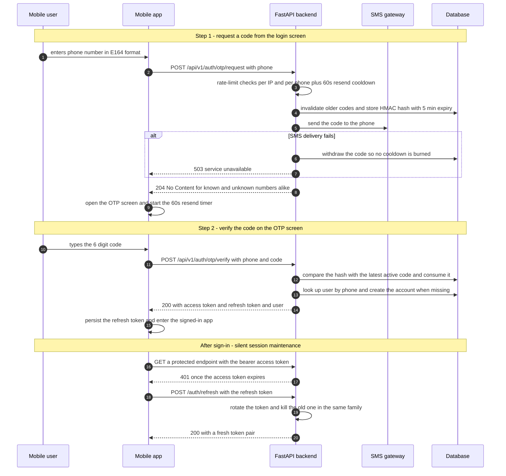
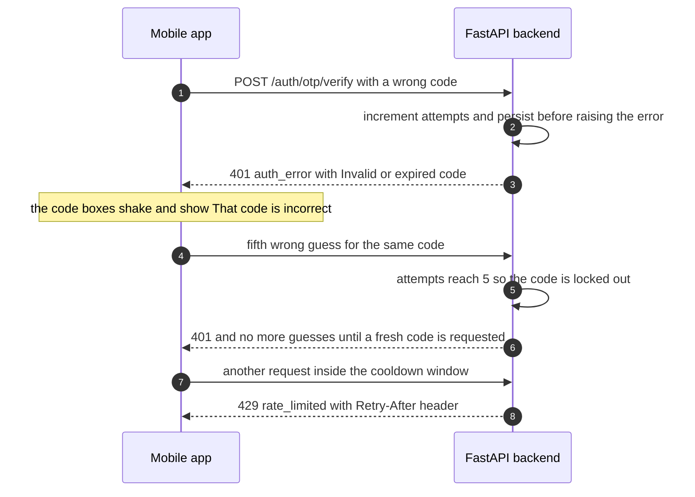

# OTP Sign-In — Technical Walkthrough & Live Demo Runbook

> Milestone showcase companion for the GetReady / Art Circle app.
> Continue with the onboarding showcase: `2026-10-31-onboarding-flow-walkthrough.md`.
> Every response below was captured live against the dev backend on 2026-10-31 — nothing is illustrative.

The app has **no passwords**. Signing in is a phone + one-time-code (OTP) flow, the same
for customers and artists. One verify call doubles as sign-up: a number that has never
signed in gets an account created on the spot (just-in-time registration).

---

## 1. The flow at a glance



Failure and abuse paths:



---

## 2. Screen-by-screen (what the client sees)

| Step | Screen | Behaviour |
|------|--------|-----------|
| 1 | `mobile/app/(auth)/welcome.tsx` | Entry point, "Log in" leads to the login form. |
| 2 | `mobile/app/(auth)/login.tsx` | Phone input prefilled `+91`, E.164 validated client-side with the **same regex the backend enforces** (`^\+[1-9]\d{6,14}$`). "Send code" disabled until valid; shows terms line. On 204 it navigates to the OTP screen carrying the phone. |
| 3 | `mobile/app/(auth)/otp.tsx` | Step 2 of 3. Six single-digit boxes (`OtpInput`, supports `autoComplete="sms-otp"` so Android/iOS autofill the code from the SMS). Auto-submits on the 6th digit. Wrong code → boxes shake + "That code is incorrect." Resend locked behind a `0:60` countdown; network errors keep the digits so Verify can retry. |
| 4 | `(app)` group | Success flips the auth gate — the router moves into the customer/artist app; onboarding (`signup.tsx` → role choice) picks up only for brand-new numbers. |

Session store: `mobile/src/context/auth/auth-provider.tsx` — the access token is kept in
memory, the refresh token persisted; a race guard discards any verify/refresh result that
lands **after** an explicit sign-out, so a slow response can never silently re-login the user.

---

## 3. API contracts (real captured examples)

Base URL: `/api/v1`. All errors share one stable JSON shape
`{ "code": "...", "message": "..." }` — the client branches on `code`, never on `message`.

### 3.1 `POST /auth/otp/request` — text a code

Request:
```json
{ "phone": "+919000000111" }
```
Response — **204 No Content**, empty body:
```
HTTP/1.1 204 No Content
```
Contract notes:
- Returns 204 whether or not the number has an account → the endpoint **can't be used to
  probe phone numbers**.
- 429 `rate_limited` (+ `Retry-After` header) when per-phone / per-IP allowance or the 60 s
  resend cooldown is exhausted.
- 503 `service_unavailable` if the SMS gateway fails — the code is withdrawn, so the user
  isn't locked out by a delivery that never arrived.

In local/dev the SMS provider is `console`: the real random code is written to the API log
(`logs/api.log`) instead of being texted — which is exactly what makes the live demo below
deterministic:
```
[console-sms] to=+919000000111 | Your Art Circle code is 893147
```

### 3.2 `POST /auth/otp/verify` — exchange a code for tokens

Wrong code (each guess consumes one attempt):
```json
// 401
{ "code": "auth_error", "message": "Invalid or expired code" }
```

Correct code — **200**, token pair + user (`access_token` / `refresh_token` truncated):
```json
{
  "access_token": "eyJhbGciOiJIUzI1NiIsInR5cCI6IkpXVCJ9.eyJzdWIiOiJiYTg2…",
  "refresh_token": "eyJhbGciOiJIUzI1NiIsInR5cCI6IkpXVCJ9.eyJzdWIiOiJiYTg2…",
  "token_type": "bearer",
  "user": {
    "id": "ba865825-3f87-4b6f-bf29-5ad345a02709",
    "phone": "+919000000111",
    "roles": [],
    "active_role": null,
    "is_phone_verified": true,
    "is_onboarded": false,
    "first_name": null,
    "last_name": null,
    "email": null,
    "avatar_url": null,
    "whatsapp_booking_updates": true
  }
}
```
- `is_onboarded: false` on a fresh number is what routes the app into artist/customer
  onboarding after sign-in; `roles: []` means no role granted yet.
- 5 min expiry / consumed codes answer the same 401 — no oracle on which half failed.

### 3.3 Authenticated call — `GET /users/me`

```
Authorization: Bearer <access_token>   →   200 (the user object above)
(no header)                             →   401
```

### 3.4 `POST /auth/refresh` — silent rotation

Mobile sends the refresh token in the JSON body; the admin web panel instead opts into an
httpOnly cookie (`X-Session-Transport: cookie`, cookie scoped to `/api/v1/auth` only).
The old token stops working on every use. **Replaying an already-rotated token revokes the
whole session family** (treated as theft/leak) — the user is signed out everywhere.
Logout is idempotent (always 204) and revokes the family too.

Token lifetimes: access **15 min**, refresh **7 days** (`backend/app/core/config.py`).

---

## 4. Abuse controls (why this is safe to put in front of real users)

| Rule | Value | Where |
|------|-------|-------|
| Code length / format | 6 digits, `secrets` CSPRNG | `app/core/security.py::generate_otp` |
| Code lifetime | 5 minutes | `otp_ttl_minutes` in `app/auth/config.py` |
| Wrong-guess lockout | 5 attempts per code | `otp_max_attempts` |
| Resend cooldown | 60 s (server-checked, can't be raced) | `otp_resend_cooldown_seconds` |
| SMS spend cap | 5 requests / phone / hour; 10 / IP / 10 min | `app/auth/constants.py` |
| Verify cap | 10 / phone / 10 min; 30 / IP / 10 min | `app/auth/constants.py` |
| Code at rest | never stored plaintext — HMAC-SHA256 hash | `hash_otp` |
| Refresh token at rest | hashed, family-id for mass revocation | `hash_token`, `RefreshToken.family_id` |
| Parallel guesses / resends | serialised per phone via a DB advisory lock | `AuthRepository.lock_phone` |
| One-shot codes | verify consumes; resend invalidates all earlier codes | `app/auth/service.py` |
| SMS failure | code withdrawn, 503 — no cooldown burned | `AuthService.request_otp` |
| Number probing | 204 for any (valid) phone, sign-up indistinguishable from sign-in | router + JIT registration |
| Audit trail | masked-phone events: requested / rejected(reason) / signed_in / delivery_failed / reuse_detected | `app/core/audit.py` |

---

## 5. Live demo runbook

### Path A — mobile app (the hero demo)

1. Start the stack from the repo root: `./dev.sh` (backend on `:8000`, mobile on Expo).
2. On the phone/emulator: Welcome → **Log in** → enter the demo number (e.g. `+919000000111`).
3. Show that "Send code" only enables on a valid E.164 number, then tap it → OTP screen with
   the six boxes and the `0:60` resend countdown.
4. Reveal the code (dev has no real SMS): read it from the log —
   `grep "console-sms" logs/api.log | tail -1`.
5. First type a **wrong code** → boxes shake, "That code is incorrect." (attempt counter, not shown to user).
6. Enter the correct code → app flips into the signed-in home; on a brand-new number this
   lands in onboarding instead, showing sign-up = sign-in.
7. Kill and reopen the app → still signed in (refresh token restore).

### Path B — curl (works on any machine, no emulator)

```bash
BASE=http://localhost:8000/api/v1
PHONE=+919000000222

# 1. request a code → expect 204
curl -si -X POST $BASE/auth/otp/request -H 'content-type: application/json' \
     -d "{\"phone\":\"$PHONE\"}" | head -1

# 2. read the code the console-SMS provider logged
grep "console-sms" logs/api.log | tail -1

# 3. verify with a wrong code → expect 401 {"code":"auth_error",…}
curl -s -X POST $BASE/auth/otp/verify -H 'content-type: application/json' \
     -d "{\"phone\":\"$PHONE\",\"code\":\"000000\"}"

# 4. verify with the real code → expect 200 token pair
TOKEN=$(curl -s -X POST $BASE/auth/otp/verify -H 'content-type: application/json' \
        -d "{\"phone\":\"$PHONE\",\"code\":\"<paste>\"}" \
        | python3 -c 'import json,sys; print(json.load(sys.stdin)["access_token"])')

# 5. authenticated call → 200; without the header → 401
curl -s $BASE/users/me -H "Authorization: Bearer $TOKEN"
curl -s -o /dev/null -w '%{http_code}\n' $BASE/users/me

# 6. (optional) burn the resend cooldown: re-run step 1 → immediate 429
```

> Demo-day note: each phone gets at most 5 code requests per hour; use a fresh demo
> number (`…222`, `…333`) per attempt rather than re-requesting.

---

## 6. Where the code lives

| Concern | File |
|---------|------|
| Routes (4 endpoints, thin forwarding) | `backend/app/auth/router.py` |
| All rules & invariants | `backend/app/auth/service.py` |
| Request/response schemas (E.164, 6-digit) | `backend/app/auth/schemas.py` |
| Rate limits & cookie transport constants | `backend/app/auth/constants.py` |
| SMS seam: console vs Fast2SMS | `backend/app/auth/sms.py` |
| Auth settings (ttl / attempts / cooldown / dev code) | `backend/app/auth/config.py` |
| Token & OTP hashing | `backend/app/core/security.py` |
| OTP code + refresh family models | `backend/app/auth/models.py` |
| Mobile screens | `mobile/app/(auth)/login.tsx`, `otp.tsx` |
| Mobile session store | `mobile/src/context/auth/auth-provider.tsx` |
| Six-box code input | `mobile/src/components/common/OtpInput.tsx` |
| Backend behavior tests (readable spec) | `backend/tests/test_auth.py` |
| Mobile session tests | `mobile/src/__tests__/auth/auth-provider.test.tsx` |
